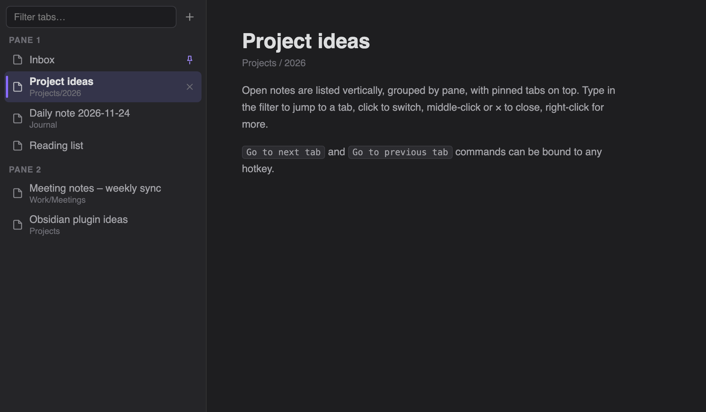
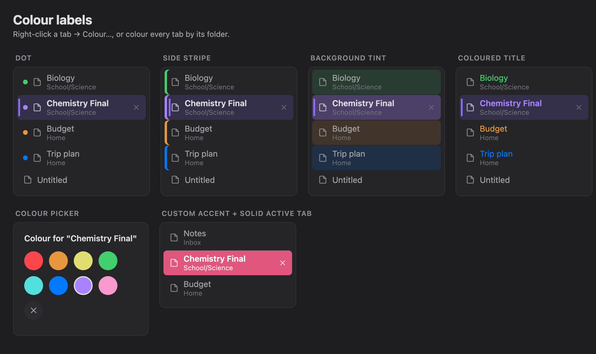
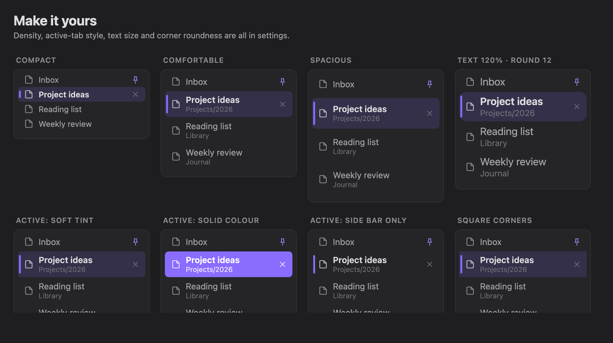
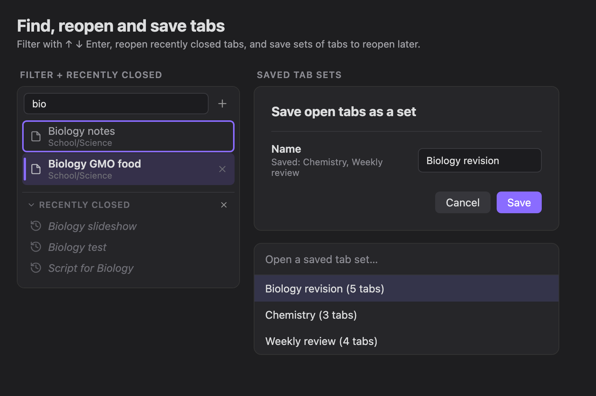
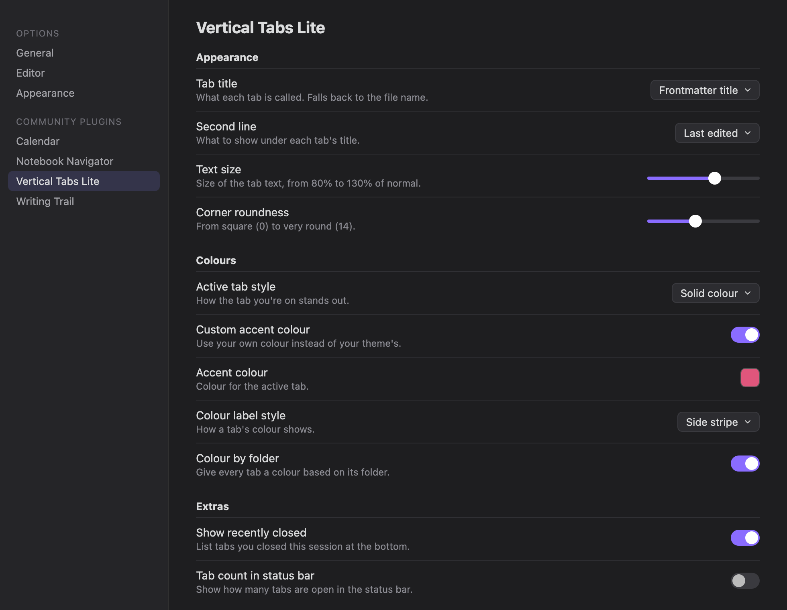

# Vertical Tabs Lite

**Your open notes as a vertical list in the sidebar, like vertical tabs in a browser.** Colour them, pin them, filter them, reopen the ones you just closed, and save whole sets of tabs for later.



Requires Obsidian 1.13.0 or newer · Desktop only · [MIT licence](LICENSE)

---

## Highlights

- **All your tabs at a glance.** One list of every open note, with the one you're on highlighted. Group it by pane, folder or colour.
- **Your order, your names.** Drag tabs into the order you want, and give any tab its own name in the list.
- **Colour labels.** Give any tab a colour, or colour every tab by its folder.
- **Make it yours.** Density, text size, corner roundness, active-tab style, what each tab is called, and what the line under it says.
- **Find tabs fast.** Filter as you type, move with ↑ ↓, open with Enter, or use the quick switcher.
- **Never lose a tab.** Recently closed tabs stay one click away, and saved tab sets bring a whole group back at once.
- **Plays nicely with other sidebar panels.** Slim rows and a "share sidebar" mode put the list under Notebook Navigator or the file explorer, so you see both at once.
- **Hide Obsidian's top tab bar** if you want this list to be the only place tabs show.

## Colour labels

Right-click a tab and choose **Colour…**, or run the command **Set colour of current tab**. Pick how colours show: a dot, a side stripe, a background tint, or a coloured title. Turn on **Colour by folder** to colour every tab automatically; colours you pick yourself still win. You can also give the active tab your own accent colour.



## Make it yours

Choose slim, compact, comfortable or spacious rows. Set text size (80–130%) and corner roundness. Pick how the active tab stands out: soft tint, solid colour, or side bar only.



Each tab can be called by its **file name**, the note's **frontmatter `title`**, or its **first heading**. The second line can show the **folder**, the **full path**, **when it was last edited** ("Edited 5 minutes ago"), or nothing.

## Use it with Notebook Navigator

Turn on **Share sidebar with other panels** and set **Density** to **Slim**. The tab list then sits under Notebook Navigator (or the file explorer) in the same sidebar, one short line per tab, and you can drag the divider to resize.

## Organise the list

- **Group by** pane, folder, colour, or nothing. Click a heading to collapse it.
- **My order:** set *Sort tabs by* to *My order*, then drag tabs up and down the list. The order is remembered, even for notes you close and open again. It only changes this list, not Obsidian's own tab order.
- **Rename tab…:** right-click a tab to give it a shorter or clearer name in the list. The file itself keeps its name. *Reset tab name* puts it back.

## Find, reopen and save tabs

- **Filter box:** type to narrow by title or folder; ↑ ↓ to move, Enter to open, Esc to clear.
- **Recently closed:** tabs you closed this session appear at the bottom; click one to reopen it.
- **Saved tab sets:** save the tabs you have open under a name ("Biology revision") and reopen them all later.
- **Quick switcher:** "Switch to open tab…" searches your open tabs by name.



## Settings

Everything is in **Settings → Vertical Tabs Lite**, and every option also shows up in Obsidian's settings search.



<details>
<summary><b>All settings</b></summary>

| Section | Setting | Default | What it does |
|---|---|---|---|
| Placement | Sidebar | Left | Which sidebar the list lives in |
| | Share sidebar with other panels | Off | Show the list below the sidebar's other panels (e.g. Notebook Navigator) instead of as its own tab |
| | Open on startup | On | Open the list when Obsidian starts |
| | Hide native tab bar | Off | Hide the horizontal tabs above your notes |
| Appearance | Density | Comfortable | Slim, Compact, Comfortable or Spacious rows |
| | Show icons | On | File-type icon next to each tab |
| | Tab title | File name | File name, Frontmatter title, or First heading |
| | Second line | Folder | Folder, Full path, Last edited, or Nothing |
| | Show file extensions | Off | Show `.pdf`, `.canvas` etc. for files that aren't notes |
| | Wrap long titles | Off | Let long titles take more than one line |
| | Text size | 100% | 80–130% |
| | Corner roundness | 6 | 0 (square) to 14 (very round) |
| | Show filter box | On | Search box above the list |
| | Show new tab button | On | The **+** button next to the filter box |
| | Show tab count | On | Number of open tabs in the filter box and pane headings |
| | Close button | On hover | When to show the ×: on hover, always, or never |
| Colours | Active tab style | Soft tint | Soft tint, Solid colour, or Side bar only |
| | Custom accent colour | Off | Use your own colour for the active tab instead of the theme accent |
| | Accent colour | Purple | The colour to use (shown when the option above is on) |
| | Colour label style | Dot | Dot, Side stripe, Background tint, or Coloured title |
| | Colour by folder | Off | Colour every tab by its folder; colours you pick still win |
| | Clear tab colours | — | Remove all the colours you've picked |
| Order and grouping | Sort tabs by | Obsidian's order | Obsidian's tab order, My order (drag to rearrange), Title (A–Z), Folder, Recently used, or Last edited |
| | Pinned tabs first | On | Keep pinned tabs at the top |
| | Group by | Pane | Pane, Folder, Colour, or Nothing (click a heading to collapse it) |
| | Forget my order | — | Clear the order you dragged tabs into |
| Extras | Show recently closed | On | List tabs closed this session at the bottom |
| | How many recently closed | 5 | 1–15 |
| | Tab count in status bar | Off | Number of open tabs in the status bar |
| Behaviour | Middle-click closes tab | On | Close a tab with the mouse wheel |
| | Double-click opens new tab | On | Double-click empty space below the tabs |
| | Tab limit | 0 (off) | Close least recently used unpinned tabs beyond this many |
| | Confirm before closing all | On | Ask before "Close all" |

**Reset to defaults** restores everything except "Hide native tab bar" and things you've set per tab: colours, names, your order and saved tab sets.

</details>

## Mouse and menus

- **Click** a tab to switch to it; **middle-click** or **×** to close it.
- **Double-click** the empty space below the tabs (or press **+**) for a new tab.
- **Hold Cmd/Ctrl and hover** to preview a note (uses the core *Page preview* plugin).
- **Click a pane heading** to collapse that pane.
- **Right-click** a tab for: Pin/Unpin, Colour…, Rename tab…, Duplicate tab, Open to the right, Open in new window, Reveal in file explorer, Copy path, Close, Close others, Close tabs below, Close duplicate tabs, Close all, Reopen closed tab, Save open tabs as a set…

## Commands

Bind any of these to a hotkey in **Settings → Hotkeys**:

| Command | What it does |
|---|---|
| Open vertical tabs | Show the tab list |
| Filter open tabs | Jump into the filter box |
| Switch to open tab… | Search your open tabs by name |
| Go to next tab / Go to previous tab | Move through the list |
| Go to tab 1–8 / Go to last tab | Jump straight to a tab |
| Pin or unpin current tab | |
| Set colour of current tab | Open the colour picker |
| Rename current tab… | Give the tab its own name in the list |
| Reopen last closed tab | |
| Close duplicate tabs | Close extra copies of the same note |
| Close all unpinned tabs | |
| Save open tabs as a set… | Name and save the tabs you have open |
| Open a saved tab set… / Delete a saved tab set… | |
| Toggle native tab bar | Show or hide Obsidian's horizontal tabs |

## Install

**From Obsidian:** Settings → Community plugins → Browse → search **Vertical Tabs Lite** → Install → Enable.

**Manually:** download `main.js`, `manifest.json` and `styles.css` from the [latest release](https://github.com/Sumi1124/vertical-tabs-lite/releases/latest), put them in `<your vault>/.obsidian/plugins/vertical-tabs-lite/`, then enable **Vertical Tabs Lite** in Settings → Community plugins.

## Notes

- Tab colours, custom names and your order follow a note when you rename or move it, and are forgotten when you delete it.
- "Recently closed" only remembers the current session.
- The pictures above are drawn from the plugin's own stylesheet on a dark theme; your theme's colours may differ.

## Build from source

```bash
npm install
npm run build   # one-off production build
npm run dev     # rebuild on save
```
